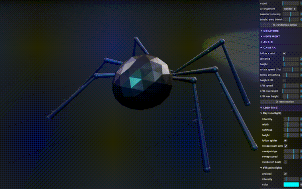
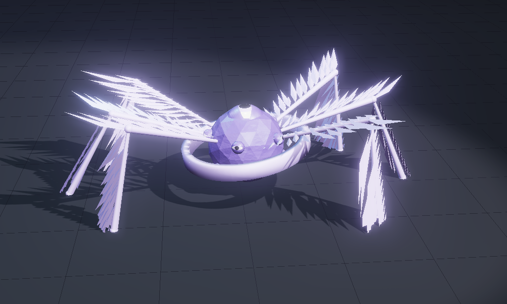
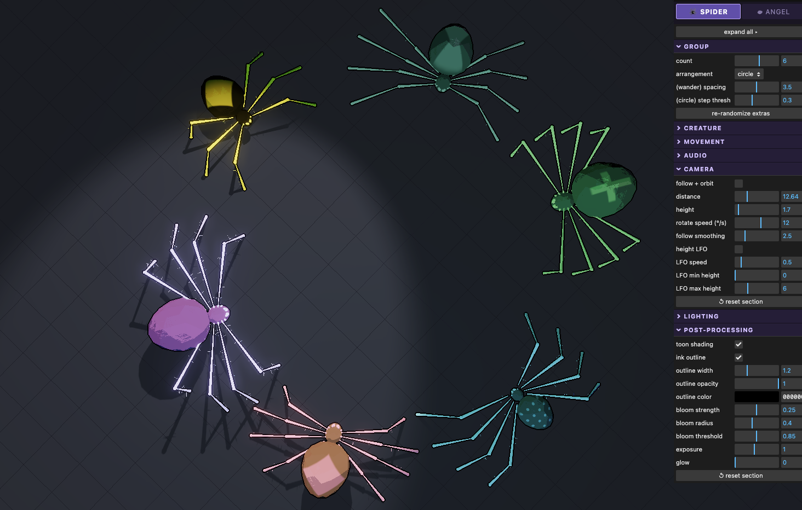

For a friend's Halloween party this year, I made a little audioreactive visual applet with a dancing 
spider and a bunch of adjustable parameters. It could change appearance, be joined by friends, or become 
a biblically-accurate angel.

It was a fun way to dip my toes into 3js a bit (I've been mainly using TouchDesigner 
the past year) as well as return to inverse kinematics for procedural animation.

[> Check out the page itself <](https://olivialynn.github.io/Audioreactive-Spider/)  
*(I recommend playing your own music as well, somewhere close to your mic :))*

I was pleased with how this turned out--especially, for something whipped together 
over the course of one very late night, fully interleaved with work I was doing to get 
our pipeline for the HATS [Alert Archive](https://alert-archive.readthedocs.io/en/latest/) 
up and running before the Vera C. Rubin Observatory started emitting alerts again. (Honestly, 
nothing beats playing around with creative coding while waiting for SLURM jobs to run...)

That said, there were a couple pain-points I'd like to improve next time I do something like this.

## Roses
*(The Positive - Successes, highlights, or things that went well.)*

### Interaction:
Leaving the sliders exposed (inspired by great work I've seen in more traditional live-coding 
shows) worked well to invite people to mess around with the parameters themselves. (Though, a couple 
people came up to me to ask if they could play around with them--next time, I could stand 
to more clearly advertise the open invitation.) Regardless, it was very fun to see them explore.

It's human nature, I think, to test the edge cases and extremes of given controls, so 
it pays to be mindful of the parameter ranges you define when inviting people to interact. 
(However--maybe it's actually more of a feature to let extreme values create demeted-looking 
dancing spiders! It reminded me of the [communities dedicated to finding in-game exploits 
in Runescape](https://www.youtube.com/watch?v=XefLzzSKW9A&t=274s), or just more general 
speedrunning scenes. A love for the game as it is, and 
in its functional state coexists with the game in a dysfunctional, stretched-to-the-limit 
state.)

### Inverse Kinematics: 
I really liked the way the dancing turned out, and it aligns with 
my own personal manifesto of "visuals should come second to the music (in any show/party 
that is not explicitly visuals-forward, ofc)" and should clearly show responses to the music 
present. In general, for me, I've been exploring that in beat response. A simple but impactful 
method for the present. Procedural animation, and dancing in general, is something I'd like 
to push forward.

## Buds: 
*(The Potential): Opportunities, new ideas, or upcoming things to look forward to.* 
### FFT buckets: 
My friend's modular synth rig was tuned a little lower than the techno 
I was working/testing to. At times, the FFT to pick out the beat in real-time was 
really struggling to work (and the music was clearly a dancable four-on-the-floor, so this 
was clearly a my-side thing). Next time, I'd like to expose parameters to allow users to 
define frequency ranges for each of the bass/mids/treble buckets that are used to 
find the most consistent beat (and maybe add an option of a fourth, sub-bass bucket). 
This will need more testing and refining in the field, I think.

### Dancing:
Having critters dancing on the screen made it a little bit easier for people 
at a small house party start dancing a little, during the more high-energy parts of the 
set, I think. Of course, I won't take full credit for that at all--but as someone who is 
often one of the few people trying to get some movement started in a mostly "let's 
stand and talk while enjoying the music" scenes, I did appreciate feeling like it wasn't 
juuuust me and two other humans dancing.

## Thorns:
*(The Challenges): Difficulties, stressors, or things that did not go as planned.*
### Live updating: 
The build itself was a little tricky. Since it was ultimately created collabing/iterating for hours with Claude (my 
personal rule is: I can only vibe-code a concept if I've already implemented it by hand 
myself, and I'd worked through a basic algorithm for IK in Unity3D maybe 4 or 5 years ago), 
I found myself trying to update a last few things at the very beginning of the evening, 
once at the party. Any prompt I gave shut the whole app down for about a minute, while Claude regenerated whichever relevant files needed 
changing).

I recall a time when [Char Stiles](https://charstiles.com/), an incredible livecoder, was giving a talk 
about a decade ago recommending a certain GLSL IDE (I want to say Kodelife?) for a number 
of reasons, one of which being that it would not push any updates if it knew the line of 
code you'd just written/edited would not run and result in the "black screen of death." 
Avoiding this outside of just shader livecoding seems like a good call, too.

